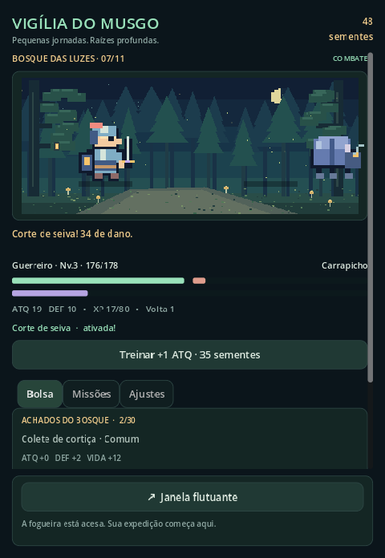

# Vigília do Musgo

Protótipo acadêmico original de RPG idle em pixel art, em português brasileiro.
Um guardião percorre o Bosque das Luzes enquanto você acompanha sua expedição.
Código Godot/GDScript e Android/Kotlin incluídos, com combate automático, quatro
classes, dez encontros e um chefe, habilidades, níveis, equipamentos, raridades,
missões, treino e progresso local. Sem conta, anúncios, telemetria ou servidor.



## Executar o jogo

Requisito: **Godot 4.5.1 Standard**, versão usada nos testes e no AAR Android.
Outras versões 4.x exigem nova validação; mantenha editor/exportador e AAR alinhados.
Abra `godot/project.godot` no editor e pressione **F5**, ou:

```sh
godot --path godot
```

Escolha Guerreiro, Arqueiro, Mago ou Curandeiro no tutorial. O combate e as
habilidades são automáticos. Em **Bolsa**, equipe ou venda os achados; em
**Missões**, resgate recompensas. **Treinar** consome sementes para aumentar ataque.
A derrota recupera a vida no abrigo sem apagar equipamentos. Após vencer o chefe,
o bosque começa uma volta mais forte. Em Ajustes, altere som/economia de bateria.
Uma nova classe inicia nova expedição, com confirmação e arquivo do save anterior.

A janela Godot funciona no desktop, inclusive para apresentação na faculdade.
O overlay sobre outros aplicativos está implementado no host Android.

## Compilar APK debug

Requisitos: JDK 17 ou 21, Android SDK **platforms;android-36**, **build-tools;35.0.0**,
**platform-tools**, licenças do SDK aceitas pelo desenvolvedor e acesso aos
repositórios Google/Maven Central. Gradle Wrapper 8.11.1, AGP 8.10.1, Kotlin 2.1.20.
O wrapper e suas verificações estão versionados; ele baixa o Gradle na primeira vez.
O export-pack não precisa de template APK do Godot: o motor vem do AAR oficial.

```sh
export GODOT=/caminho/para/Godot_v4.5.1-stable
export ANDROID_HOME=/caminho/para/android-sdk
./tools/build_android.sh
adb install -r android/app/build/outputs/apk/debug/app-debug.apk
```

Alternativa manual (Linux/macOS; no Windows use `gradlew.bat`):

```sh
godot --headless --path godot --editor --import --quit
godot --headless --path godot --export-pack "Android Pack" ../android/app/src/main/assets/game.pck
cd android
./gradlew testDebugUnitTest lintDebug assembleDebug
```

O aplicativo requer **Android 8 / API 26**, OpenGL ES 3, processador **arm64-v8a**
ou **x86_64**. Target/compile API 36. Dispositivos somente ARM de 32 bits não estão
neste APK. A assinatura debug serve para demonstração; nenhuma chave de publicação
é incluída. Consulte [VALIDACAO.md](docs/VALIDACAO.md) para os resultados reais.

## Janela flutuante e consentimento

1. Toque em **Janela flutuante**; autorize a sobreposição na tela do Android.
2. Volte e toque novamente. No Android 13+, autorize as notificações quando solicitado.
3. Toque mais uma vez para iniciar. Arraste o cabeçalho, ajuste pelo canto inferior,
   use **↗** para voltar ou **×** para fechar. A notificação também permite fechar.

A janela é uma expedição de **até cinco minutos**. O Godot calcula previamente
301 snapshots por meio do mesmo motor determinístico, sem modificar o save.
Kotlin escolhe um quadro por segundo com `elapsedRealtime`. Ao voltar, o Godot
reaplica os ticks decorridos sobre o checkpoint salvo. Não há uma segunda lógica
de RPG nem duas instâncias Godot. Equipamentos e missões são alterados na tela
completa; a janela é uma apresentação compacta da mesma expedição.

O serviço `specialUse` é iniciado somente pela Activity visível, com notificação
e justificativa no manifesto. Não usa AccessibilityService, captura de tela,
wakelock, reinício no boot ou alarmes. Fecha com a tela desligada, retorno ao jogo,
remoção da tarefa, fim do prazo ou falha. Negação de permissão e restrições do
fabricante preservam a tela completa. Uso de `specialUse` não implica aprovação
para a Play Store; publicação comercial exigirá análise própria do uso declarado.
Veja [contrato Android](android/README.md) e [arquitetura](docs/ARQUITETURA.md).

## Persistência e tempo

Save em `user://session.json`, com checksum SHA-256, gravação temporária, backup,
validação de esquema e recuperação. O checksum detecta corrupção; não é proteção
contra adulteração deliberada. Autosave a cada 15 segundos e ao suspender/fechar.
Falhas aparecem na interface, sem apagar silenciosamente o save. Formatos futuros
são protegidos; nova expedição arquiva os arquivos anteriores antes de gravar.

O idle é limitado a **duas horas por recuperação**. No mesmo boot do Android,
usa relógio monotônico que inclui suspensão. Após reboot ou reinício do jogo no
desktop, usa tempo civil limitado e ignora retrocessos. Sem servidor, não existe
prova absoluta da hora entre reinicializações: alterar a data pode influenciar
a recompensa limitada. Nenhuma recompensa depende de rede.

## Organização

```text
godot/
  data/                 classes, inimigos, equipamentos e missões em JSON
  scripts/core/         motor, sessão autoritativa e persistência
  scripts/platform/     relógio e ponte opcional para Android
  scripts/presentation/ interface responsiva e animação
  assets/               sprites, cenário, ícone e sons originais
  tests/                testes determinísticos, saves e sessão
android/
  app/src/main/         Activity, plugin, serviço e Canvas de overlay
  app/src/test/         testes JVM de timeline e limites da janela
tools/                  gerador de arte e scripts de teste/build
docs/                   arquitetura acadêmica, créditos e evidências
```

## Testes e apresentação

```sh
GODOT=/caminho/para/godot ./tools/test.sh
cd android && ./gradlew testDebugUnitTest lintDebug
```

Os testes headless usam diretório temporário para não tocar no save do jogador.
Para rodar diretamente: `godot --headless --path godot --script res://tests/test_runner.gd`.
No sandbox deste trabalho, `XDG_DATA_HOME`, `XDG_CACHE_HOME` e `XDG_CONFIG_HOME`
foram apontados para `work/` fora do repositório. O script de testes faz isolamento
sem depender desses caminhos específicos.

Há [checklist manual](docs/TESTES_MANUAIS.md) para permissões, rotação, suspensão,
revogação e bateria. Build e testes JVM não comprovam o comportamento em aparelho.
As capturas são da execução real no desktop; não são capturas Android.
Para demonstrar: escolha uma classe, aguarde o primeiro combate, equipe um achado,
resgate a primeira missão, mostre Ajustes e então explique/abra a janela Android.

## Originalidade e licença

Nome, personagens, dados, interface, sprites e sons foram criados neste projeto.
A inspiração é apenas o conceito geral de uma pequena expedição automática; não
foram usados recursos de TBH: Task Bar Hero. Código MIT; arte e som próprios CC0.
O gerador reproduz os arquivos: `python3 tools/generate_assets.py` (Python 3 e Pillow).
Godot, AndroidX, Kotlin e Gradle têm licenças próprias, descritas nos
[créditos](docs/CREDITOS.md). O padrão visual do overlay é desenhado por código Kotlin.

## Git e publicação

O projeto possui Git local, branch `main` e commits por etapa. O estado da publicação
e os comandos restantes estão em [VALIDACAO.md](docs/VALIDACAO.md). Não publique
caches, SDKs, `.env`, `local.properties`, saves, chaves ou arquivos de assinatura.
O `.gitignore` cobre os artefatos de build e segredos comuns. Não sobrescreva um
repositório existente com o mesmo nome.
